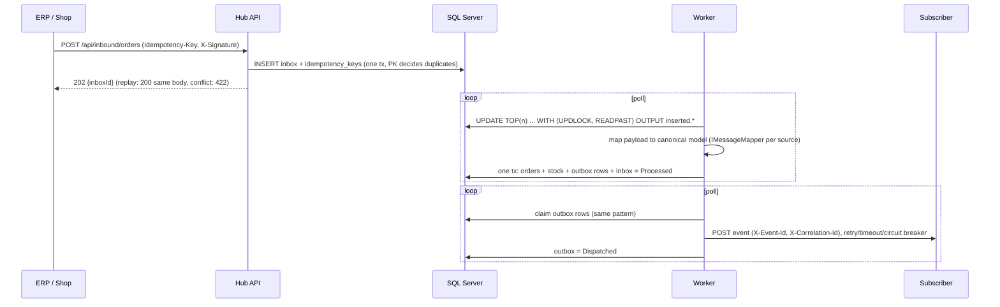

# WMS Integration Hub

An integration hub that sits between external systems (an ERP and an e-commerce shop, both simulated) and a
warehouse management system. It accepts orders, ASNs and product master data over webhooks and CSV file drops,
stages everything in an inbox, applies it to the WMS tables, and publishes resulting events to subscribers
through a transactional outbox.

Built with .NET 10, ASP.NET Core minimal APIs, SQL Server, **Dapper + hand-written T-SQL** (no EF Core on
purpose), DbUp, Polly (via `Microsoft.Extensions.Http.Resilience`), CsvHelper, FluentValidation, xUnit v3 and Shouldly.

## Problem

Integrations fail in boring, expensive ways: a sender retries and the same order is created twice; two workers
pick the same message; a subscriber is down and an event is lost; an order arrives before the product it
references; a CSV has one bad row and the whole file is rejected. This project handles each of those
explicitly and tests them against a real SQL Server.

## Architecture

```
src/IntegrationHub.Core     canonical model, mappers (Strategy), idempotency/retry/HMAC logic,
                            InboxProcessor, OutboxDispatcher (no infrastructure dependencies)
src/IntegrationHub.Data     Dapper repositories, DbUp scripts (tables, indexes, stored procedures)
src/IntegrationHub.Api      inbound webhooks, admin endpoints, /health, fake subscriber
src/IntegrationHub.Worker   BackgroundServices: inbox processor, outbox dispatcher, CSV file drop
tests/...UnitTests          mappers, idempotency decision, backoff, HMAC, CSV validation
tests/...IntegrationTests   real SQL Server: unique DB per run, dropped afterwards
```

**API and worker are separate processes.** The inbox claim query is built for competing consumers, so workers
can be scaled out independently, a crashing worker cannot take the webhook endpoint down, and slow processing
never adds latency to intake. The cost is running two processes locally.



## Guarantees (and non-guarantees)

| Concern | What you get |
| --- | --- |
| Intake idempotency | Same `(source, Idempotency-Key)` + same body: original result (`200`, `Idempotent-Replayed: true`), no new row. Same key + different body: `422`. Enforced by the primary key of `idempotency_keys`, so concurrent duplicates are safe, not just sequential ones. The body hash is byte-exact. |
| Business idempotency | The same order re-sent under a new key is detected by `UNIQUE (source_system, external_order_id)` and processed as a no-op. Same for ASNs. |
| Processing | Each inbox row is applied **exactly once** to the WMS tables: the domain change, the outbox rows and `status = Processed` commit in one local transaction. A claimed row carries a lease; if a worker dies, the row is re-claimed after the lease. Late writes from the old worker are fenced off by `attempt_count`. |
| Retries | Exponential backoff with jitter (`RetryPolicy`), stored in `next_attempt_at`. After `MaxAttempts` the row is dead-lettered. Mapping errors (bad payload) are dead-lettered at once, because retrying cannot fix them. Unknown SKU is retried, because master data may simply arrive later. |
| Delivery to subscribers | **At-least-once.** An event is marked dispatched only after every matching subscriber returned 2xx. A crash after delivery, or one failing subscriber out of two, means re-delivery. Subscribers must de-duplicate by `X-Event-Id`. |
| Ordering | **Not guaranteed.** Concurrent workers, retries and backoff reorder messages. Events carry the full new state (e.g. `onHand`), not deltas only, so consumers can cope. |

## Why Dapper + DbUp (and not EF Core)

The interesting parts of this system are SQL: the claim query with lock hints, filtered indexes, a TVP bulk
upsert, window-function reports. With Dapper the SQL that runs is the SQL in the code: easy to review, explain,
and tune with an execution plan. DbUp keeps migrations as plain numbered `.sql` files embedded in the assembly,
applied once each and journaled. The trade-off: no change tracking and more hand-written mapping, which is fine
for a service with a small, stable schema.

## T-SQL highlights

**Competing consumers without double processing** (`InboxRepository.ClaimBatchAsync`). `READPAST` skips rows
another worker is locking right now instead of waiting on them; `UPDLOCK` makes the read-then-update atomic:

```sql
WITH due AS (
    SELECT TOP (@BatchSize) * FROM dbo.inbox WITH (UPDLOCK, READPAST, ROWLOCK)
    WHERE status IN (N'Received', N'Failed', N'Processing') AND next_attempt_at <= SYSUTCDATETIME()
    ORDER BY next_attempt_at)
UPDATE due SET status = N'Processing', attempt_count += 1,
               next_attempt_at = DATEADD(second, @LeaseSeconds, SYSUTCDATETIME())   -- lease
OUTPUT inserted.id, inserted.payload, ...;
```

**Filtered index** that only contains claimable rows, so it stays tiny as history grows. The query repeats the
filter with literals, which is what lets the optimizer use a filtered index:

```sql
CREATE INDEX IX_inbox_pending ON dbo.inbox (next_attempt_at) INCLUDE (status)
    WHERE status IN (N'Received', N'Failed', N'Processing');
```

**`usp_UpsertProducts`**: a table-valued parameter carries the whole CSV in one round trip. UPDATE-then-INSERT
under `UPDLOCK, SERIALIZABLE` instead of `MERGE` (which has a long bug history and needs `HOLDLOCK` anyway).
Unchanged rows are not touched, using a NULL-safe compare:

```sql
WHERE EXISTS (SELECT p.name, p.uom, p.weight_kg, p.barcode
              EXCEPT SELECT s.name, s.uom, s.weight_kg, s.barcode);
```

**`usp_StockTurnoverReport`**: opening balance + running total + day-over-day change, served by a covering index
on `(sku, occurred_at) INCLUDE (quantity)` that already delivers rows in window order:

```sql
COALESCE(o.opening_qty, 0) + SUM(d.net_change) OVER (PARTITION BY d.sku ORDER BY d.movement_date
                                                     ROWS BETWEEN UNBOUNDED PRECEDING AND CURRENT ROW),
b.qty_out - LAG(b.qty_out) OVER (PARTITION BY b.sku ORDER BY b.movement_date) AS qty_out_change
```

**`usp_IntegrationStats`**: CTE + `GROUP BY` per source and day: counts by status, average latency
(`DATEDIFF_BIG`), failure rate; covered by `IX_inbox_received_at`.

Other details: all string columns are `nvarchar`, so Dapper's default `nvarchar` parameters never cause an
implicit conversion on an indexed column; every statement is parameterized; product rows are locked in SKU
order inside a transaction to avoid deadlocks between concurrent orders.

## Run it locally

Prerequisites: .NET 10 SDK, SQL Server (Express is fine). Default connection string (both hosts, in `appsettings.json`):

```
Server=localhost\SQLEXPRESS;Database=WmsIntegrationHub;Trusted_Connection=True;TrustServerCertificate=True
```

The API creates the database and applies migrations on startup. Start it first, then the worker:

```bash
dotnet run --project src/IntegrationHub.Api       # http://localhost:5080
dotnet run --project src/IntegrationHub.Worker    # watches ./filedrop, delivers to /fake-subscriber/*
```

Load master data first (orders for unknown SKUs are retried until the product exists):

```bash
mkdir -p filedrop && cp samples/products.csv filedrop/
# -> filedrop/processed/<ts>_products.csv + .report.json (4 imported, lines 5 and 6 rejected)
```

Send an ERP order twice with the same key (`202`, then `200` with the same `inboxId`):

```bash
curl -i -X POST http://localhost:5080/api/inbound/orders \
  -H "Content-Type: application/json" -H "X-Source-System: erp" \
  -H "Idempotency-Key: erp-SO-1001" -H "X-Correlation-Id: demo-trace-001" \
  --data-binary @samples/order-erp.json
```

The shop source requires an HMAC signature in Development (`Inbound:Sources:shop:HmacSecret`):

```bash
SIG="sha256=$(openssl dgst -sha256 -hmac 'dev-only-shop-secret' -hex < samples/order-shop.json | sed 's/^.* //')"
curl -i -X POST http://localhost:5080/api/inbound/orders \
  -H "Content-Type: application/json" -H "X-Source-System: shop" \
  -H "Idempotency-Key: web-555" -H "X-Signature: $SIG" --data-binary @samples/order-shop.json
```

More: `samples/asn-erp.json` (`POST /api/inbound/asns`), `samples/orders.csv` (drop into `filedrop/`).

See the result:

```bash
curl http://localhost:5080/fake-subscriber/wms-ui           # delivered events, with the original correlation id
curl http://localhost:5080/api/admin/stats                  # usp_IntegrationStats, last 7 days
curl http://localhost:5080/api/admin/dead-letters
curl -X POST http://localhost:5080/api/admin/dead-letters/6/replay
curl "http://localhost:5080/api/admin/reports/stock-turnover?from=2026-11-01&to=2026-11-30"
curl http://localhost:5080/health
```

With Docker: `docker compose up --build` (SQL Server 2022 + API on port 5080 + worker; `./filedrop` is mounted).

### Endpoints

| Method | Path | Purpose |
| --- | --- | --- |
| POST | `/api/inbound/orders`, `/api/inbound/asns` | Webhooks. Headers: `X-Source-System` (erp/shop), `Idempotency-Key` (required), `X-Signature` (if the source has a secret), `X-Correlation-Id` (optional) |
| GET | `/api/admin/dead-letters?take=50` | Dead-lettered inbox messages |
| POST | `/api/admin/dead-letters/{id}/replay` | Re-queue one dead letter with a fresh attempt budget |
| GET | `/api/admin/stats?from=&to=` | `usp_IntegrationStats` |
| GET | `/api/admin/reports/stock-turnover?from=&to=&sku=` | `usp_StockTurnoverReport` |
| GET | `/health` | SQL Server connectivity |
| POST/GET | `/fake-subscriber/{name}` | Demo subscriber (Development / `FakeSubscriber:Enabled`) |

### Observability

Console logging with scopes (`json` formatter by default, single-line `simple` in Development). The correlation
id is taken from `X-Correlation-Id` (or generated), stored on the inbox row, copied to every outbox row, sent as
`X-Correlation-Id` on the outbound webhook and logged by the receiver, so one `grep` shows the whole path.

## Tests

```bash
dotnet test                                   # unit + integration
dotnet test --project tests/IntegrationHub.UnitTests
```

Integration tests need a SQL Server. They default to `localhost\SQLEXPRESS` with Windows auth; override with
`WMS_TEST_SQL` (server-level connection string, no database). Each run creates `WmsHubTest_<guid>`, applies the
real DbUp scripts and drops the database at the end. Covered: duplicate webhook gives one row, conflicting key
gives `422`, 12 concurrent requests with one key give exactly one row, HMAC, three concurrent workers over 200
messages (each processed exactly once, stock exact), retry then dead letter then replay, rollback leaves no
order/stock/outbox rows, outbox delivery and retry, and all three stored procedures on seeded data.

CI (`.github/workflows/ci.yml`) runs build and all tests against a SQL Server 2022 service container.

## Trade-offs and what's next

- **No stock availability check.** Accepting an order allocates stock even below zero; a real WMS would
  backorder or reject. Processing an ASN books the goods as received (no separate receiving step).
- **Per-subscriber delivery state is not tracked.** One failing subscriber causes re-delivery to the others.
  Next step: an `outbox_deliveries` table per subscriber.
- **Admin endpoints are unauthenticated.** Put them behind an auth policy before any real deployment.
- **Only the API runs migrations** (DbUp has no cross-process lock); the worker starts after it.
- **Outbox dead letters** have no admin endpoint yet (visible in the `outbox` table).
- **Polling** (inbox, outbox, folder) every 2-5 s. Good enough here; Service Broker or a real queue would cut latency.
- **Retention**: processed inbox/outbox rows and idempotency keys are kept forever; add a cleanup job.
